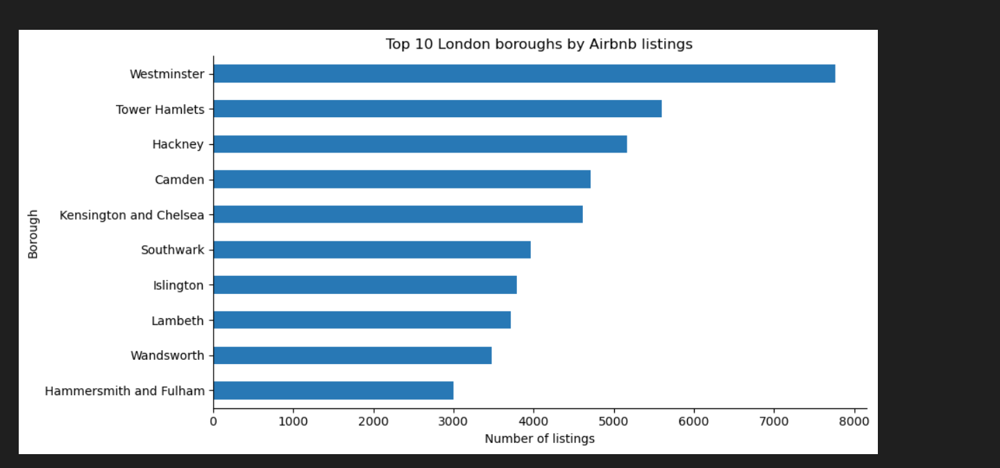
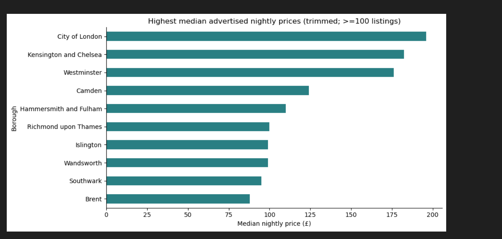
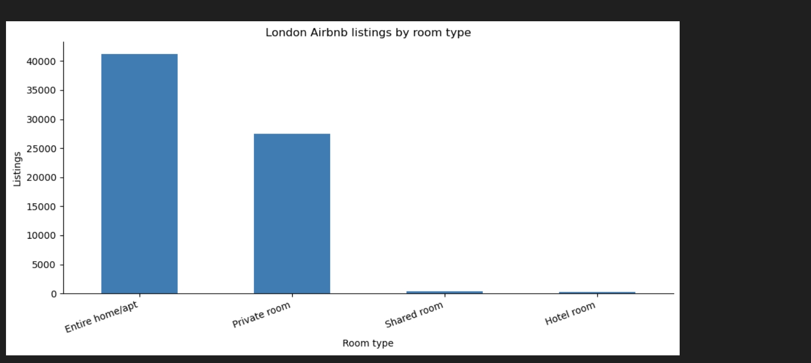
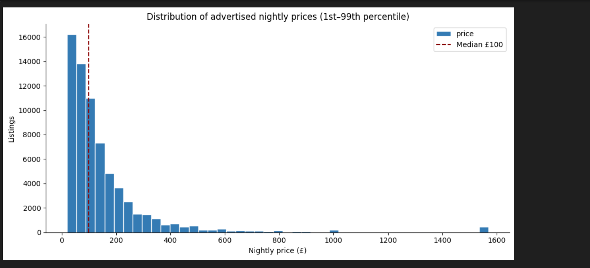

# London Airbnb Market Analysis | Python

An exploratory analysis of **69,351 London Airbnb listings across 33 boroughs** using Python. This project examines where listings are concentrated, how advertised nightly prices vary, the mix of room types, availability, reviews, and host concentration.

## Key findings

- **Westminster** has the most listings: **7,763**.
- **City of London** has the highest median advertised nightly price (**£196**) among boroughs with at least 100 listings in the filtered price sample.
- **Entire homes/apartments** are the most common room type: **41,224 listings**.
- The median advertised nightly price is **£100** in the filtered sample.
- The data contains **45,229 distinct hosts**; the top 10 hosts account for **2.73%** of listings.

## Tools and techniques

- **Python:** Pandas, NumPy, Matplotlib
- **Data preparation:** missing-value assessment, duplicate checks, numeric/date conversions, handling invalid prices
- **Analysis:** groupby, aggregation, median comparisons, percentile filtering, host concentration, sampling
- **Visualisation:** bar charts, box plots, histograms, scatter plots

## Method

1. Inspect the dataset and audit missing values, duplicates and price outliers.
2. Deduplicate listing IDs and remove completely empty columns.
3. Analyse advertised prices on a **1st–99th percentile filtered sample** of positive-price listings (68,438 rows); retain the full cleaned dataset for supply counts.
4. Compare listing counts and prices across boroughs, room types and hosts.
5. Export summary tables for reproducibility.

## Repository files

- `London_Airbnb_Analysis.ipynb` — analysis notebook, with explanations and charts
- `requirements.txt` — Python dependencies
- `listingss.csv` — obtain the source dataset separately and place it alongside the notebook, preserving this exact filename
- `outputs/` — created automatically when the notebook runs

## Run locally

```bash
python -m pip install -r requirements.txt
jupyter notebook London_Airbnb_Analysis.ipynb
```

Place `listingss.csv` in the repository directory before running the notebook from top to bottom.

## Dataset Information

- **Dataset:** London UK Airbnb Open Data
- **Source:** [Kaggle – whenamancodes](https://www.kaggle.com/datasets/whenamancodes/london-uk-airbnb-open-data)
- **Dataset Period:** October 2022
- **Total Listings:** 69,351
- **Coverage:** 33 London boroughs
- **Dataset File:** `listingss.csv`

The dataset was sourced from Kaggle and used to explore Airbnb listing distribution, accommodation types, nightly pricing patterns, availability and host activity across London.

## Data Visualisations

### Top 10 London Boroughs by Airbnb Listings


### Median Nightly Prices by Borough


### Airbnb Listings by Room Type


### Distribution of Advertised Nightly Prices

